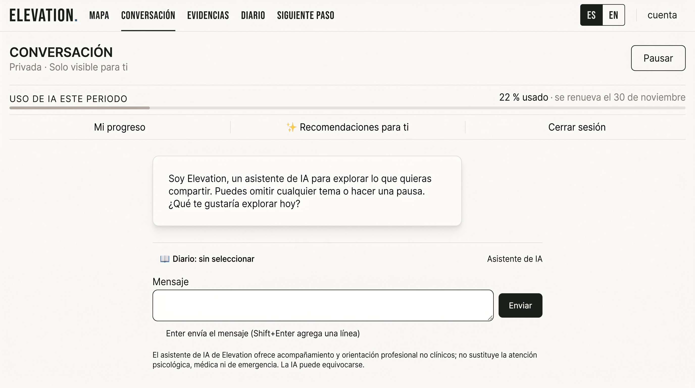

# ES-320 — Conversación amplia y cercana

**Estado:** diseño opción A aprobado por Alejo el 16-nov-2026; implementación autorizada en la rama `ES-320-mejorar-conversacion`.  
**Pantalla:** `/app/chat`, dentro del marco global de persona.  
**Alcance:** jerarquía y distribución frontend; no cambia APIs, datos ni reglas del producto.

## Mockup aprobado



## Problema observado

En la captura original el chat queda como una columna angosta dentro de una pantalla ancha. El CSS limita `.chat-main` a `760px`; además, una cabecera interna centrada vuelve a presentar la marca y el selector de idioma que ya existen en el marco global. Eso reduce el espacio de lectura/escritura y repite navegación.

## Diseño aprobado

### Escritorio

```text
┌ Elevation + navegación global + idioma + cuenta (marco intacto) ───────────┐
│ Conversación / privacidad                         Pausar / Retomar      │
│ Uso de IA + barra                                                        │
│ Mi progreso     | Recomendaciones | Administración* | Cerrar sesión      │
│                                                                           │
│           ┌──────── hilo de lectura: máximo aprox. 900 px ────────┐      │
│           │ bienvenida, mensajes, estados y recomendaciones       │      │
│           └────────────────────────────────────────────────────────┘      │
│ Diario: sin seleccionar                                  Asistente de IA │
│ Mensaje                                                                    │
│ ┌──────────────────────── textarea amplia ─────────────────────┐ Enviar  │
│ Enter envía · Shift+Enter agrega una línea · límites actuales            │
└───────────────────────────────────────────────────────────────────────────┘
```

`*` Administración solo aparece para los roles autorizados que ya existen. Las acciones conservan etiquetas de texto visibles. La opción A elimina únicamente la cabecera interna de marca/idioma; no elimina la cabecera de `Frame`.

### Móvil y tableta

```text
┌ Marco global existente: marca, navegación, idioma y cuenta se reacomodan ┐
│ Conversación / privacidad                         Pausar / Retomar         │
│ Uso de IA + barra                                                         │
│ Progreso · Recomendaciones · Administración* · Cerrar sesión               │
│ ┌──── hilo a ancho útil ────────────────────────────────────────────────┐ │
│ │ bienvenida, mensajes, estados y recomendaciones                       │ │
│ └───────────────────────────────────────────────────────────────────────┘ │
│ Diario / Asistente de IA                                                  │
│ Mensaje                                                                   │
│ ┌──────────────── textarea ────────────────────────────────────────────┐ │
│ └───────────────────────────────────────────────────────────────────────┘ │
│ ┌──────────────────────── Enviar ──────────────────────────────────────┐ │
└──────────────────────────────────────────────────────────────────────────┘
```

El encabezado global actual se mantiene y se adapta con sus reglas existentes; no se agrega un menú hamburguesa. En tablet las acciones pueden ocupar una segunda fila. Debe evitarse el scroll horizontal y el botón Enviar pasa debajo del campo a menos de 640 px.

## Componentes y tokens

Se reutilizan `ChatPage`, `ChatBar`, `ChatInput`, `ChatContext`, `ChatLimitsNotice`, el marco global, sus controles y las clases existentes de `space.css`. `ChatBar` recibirá el grupo de acciones de la pantalla y lo presentará en una fila debajo del uso de IA; pausa/reanudación permanece junto a conversación/privacidad. La lógica de navegación, recomendaciones, administración condicional y check-out sigue en `ChatPage`.

Se amplía `.chat-main` hasta un máximo aproximado de `1240px` y se limita el hilo de lectura a `900px`; el compositor puede aprovechar el ancho exterior disponible. Se usan los tokens activos de `frontend/src/styles/tokens.css` (`--elv-bg`, `--elv-text-1/2`, `--elv-line-control`, `--elv-link` y `--elv-focus`) y los estilos de controles de `space.css`. No se agregan dependencias, tokens, colores de marca ni componentes de backend.

## Textos ES/EN

Se conservan las claves de i18n vigentes, sin copy nuevo: `conversation`, `convPrivate`, `progress`, `rec_title`, `admin_title`, `pause`/`resume`, `diaryNone`, `composer`, `send`, `enterSends` y `signOut`. La bienvenida y los textos del asistente permanecen exactamente como están.

## Flujo y estados que deben conservarse

La persona sigue entrando a `/app/chat` dentro del marco global. Ve privacidad, uso de IA, pausa/reanudación y las acciones que su rol ya permite; lee el hilo centrado y escribe en el compositor. El selector del diario sigue siendo opcional y plegable. Cerrar sesión mantiene el check-out existente y no lo omite.

No se ocultan ni reemplazan estados implementados: carga, conversación vacía, preparación/respuesta, envío en curso o sin confirmar, error/reintento, sesión vencida, pausa, límite agotado, diario abierto/cerrado, recomendaciones cargando/error/resultados y panel administrativo según rol.

## Teclado y accesibilidad

Se preservan el foco visible, el orden de tabulación y los nombres accesibles. Las acciones nuevas de distribución mantienen texto visible y tamaño táctil adecuado. `Enter`/`Shift+Enter`, `Escape` y retorno del foco en el selector del diario, regiones `status` y anuncios `aria-live` conservan su comportamiento. En anchos pequeños las acciones envuelven sin recortarse.

## Límites de producto

La conversación continúa siendo privada, pausable y de acompañamiento no clínico. No se agregan preguntas iniciales, sugerencias profesionales ni promesas de empleabilidad. No se alteran check-in/check-out, consentimiento para consultar el diario, APIs, LLM, almacenamiento, roles ni migraciones.
